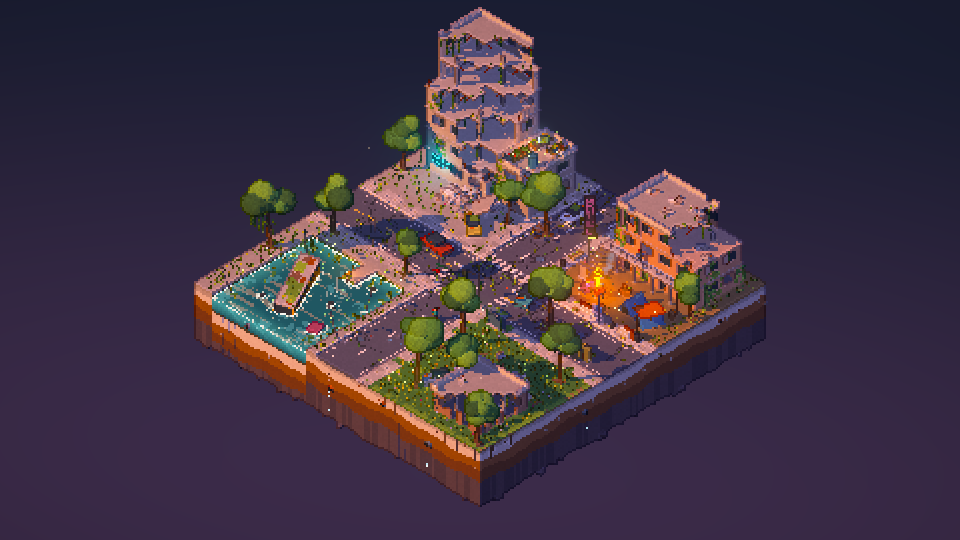

# 废土微景观 · Ruins Diorama

一个用 **Three.js + Vite** 做的 3D 像素风微缩景观：一块漂浮在夜空中的方形“城市切片”。城市已经荒废，被植物重新占领，几个幸存者 NPC 各自按习惯生活，主角由玩家操控。



## 运行

```bash
npm install
npm run dev          # 开发服务器（黄昏）
npm run night        # 夜晚版本（等同于 /?time=night）
npm run build        # 构建到 dist/
npm run shots        # 无头 Chrome 渲染 shots/overview.png、closeup1.png、closeup2.png
npm run demo         # 录制 shots/demo.mp4（960×540，26 秒）
```

URL 参数：
- `?time=night`：夜晚，月光、萤火虫更多、霓虹更亮
- `?px=3`：像素块大小（默认按屏幕高度自动取 2~4）

## 操作

| 操作 | 说明 |
| --- | --- |
| `W A S D` / 方向键 | 按屏幕方向移动主角（会和建筑、车辆、水面发生碰撞） |
| 鼠标点击地面 | 自动寻路走过去（A* 寻路） |
| 鼠标滚轮 | 缩放镜头 |
| `O` | 在总览和跟随镜头之间切换 |

开场先展示整块微景观总览，约 3 秒后（或按下任意移动键时）镜头推近并跟随主角。主角身后跟着一个穿黄雨衣的小女孩和一条狗；狗停下来时会坐下。

## 场景内容

- **西北**：向前倾塌的六层塔楼（裸露钢筋、爬山虎、苔藓、碎石堆、断掉的青色霓虹灯牌）；旁边两层小楼的屋顶菜园（种植箱、水箱、太阳能板、晾衣绳、灯笼、爬梯）
- **东北**：三层汽车旅馆（东端坍塌），二楼外廊、楼梯；竖排 **MOTEL** 霓虹招牌（T 已坏，E 抽搐闪烁，整体偶尔掉电）
- **营地**：两顶防水布帐篷、油桶篝火（火焰、火星、烟）、破沙发、木箱、水桶、水泥隔离墩、轮胎、沙袋、串灯
- **街道**：十字路口，开裂的沥青、褪色车道线、斑马线、坑洼积水、裂缝里长出的草；冲破路面的大树；生锈的汽车（压扁的、侧翻的）、倾斜的红绿灯（黄灯闪烁）、歪斜的路牌和停车标志、坏掉的路灯、公交站、购物车
- **西南**：被水淹没的下沉广场，半沉的公交车（车顶长满苔藓）、只露车顶的汽车、水中路灯、浮萍、芦苇、轮胎；可以走上去的栈桥和灯笼；垂着藤蔓的大树
- **东南**：长满野草野花的街心公园、破败小店、碎石堆
- **切面**：地块四周可见地层（路面/碎石/混凝土/泥土/岩石），钢筋、管道、树根从断面露出，底部悬挂碎石和滴水

## NPC 习惯

| NPC | 行为 |
| --- | --- |
| 园丁（草帽） | 在屋顶菜园里依次给三块菜地浇水，回水箱灌水，偶尔停下发呆 |
| 厨师（毛线帽） | 在油桶篝火边搅锅、去木箱取东西、再搅、伸手烤火 |
| 读书人 | 坐在破沙发上看书，时不时伸懒腰 |
| 钓鱼老人 | 坐在栈桥尽头钓鱼，浮漂在水面激起涟漪，隔一阵收竿 |
| 拾荒者（兜帽） | 在公园碎石堆里挖掘，把东西放进购物车，再换个地方挖 |
| 瞭望者（红帽） | 在汽车旅馆二楼外廊来回巡逻，停下来用望远镜张望 |
| 橘猫 | 在公园和街道上闲逛、坐下、舔毛 |

## 技术要点

- 低分辨率 HDR 渲染（约 480×270）→ 最近邻放大；相机按像素网格吸附，残差用亚像素平移补偿，镜头移动时像素不抖动
- 深度 + 法线描边（用局部颜色的暗色描边，凸棱提亮；发光体不描边）
- `MeshToonMaterial` 五段色阶 + 硬阴影（BasicShadowMap）+ 世界坐标噪声纹理
- 草、藤蔓、树冠在顶点着色器里随风摆动；法线 pass 使用相同的摆动，描边不会错位
- 泛光（两级模糊），霓虹/火焰闪烁；粒子（萤火虫、火星、烟、浮尘、滴水、浇水水滴）全部在 GPU 上计算
- 风格化水面：岸边泡沫、障碍物泡沫、夕阳倒影条纹、浮漂涟漪、像素闪光；侧面有体积带和光柱
- 几乎所有静态几何体都合并成少量 InstancedMesh，软件渲染（SwiftShader）也能跑
- 角色是程序化的方块小人，走路、挖土、浇水、钓鱼、看书等动作都由程序生成

## 目录

```
src/main.js        入口：渲染器、灯光、相机、输入、录制接口
src/world.js       场景搭建 + 碰撞网格 + A* 寻路
src/characters.js  人物/动物模型、动作、NPC 日程、玩家与跟随者
src/post.js        后处理管线（描边、泛光、像素化合成）
src/materials.js   卡通材质（噪声 + 摆动）
src/water.js       水面着色器
src/particles.js   GPU 粒子
src/batch.js       实例化合批工具
scripts/shoot.mjs  无头截图 / 录制视频
```
