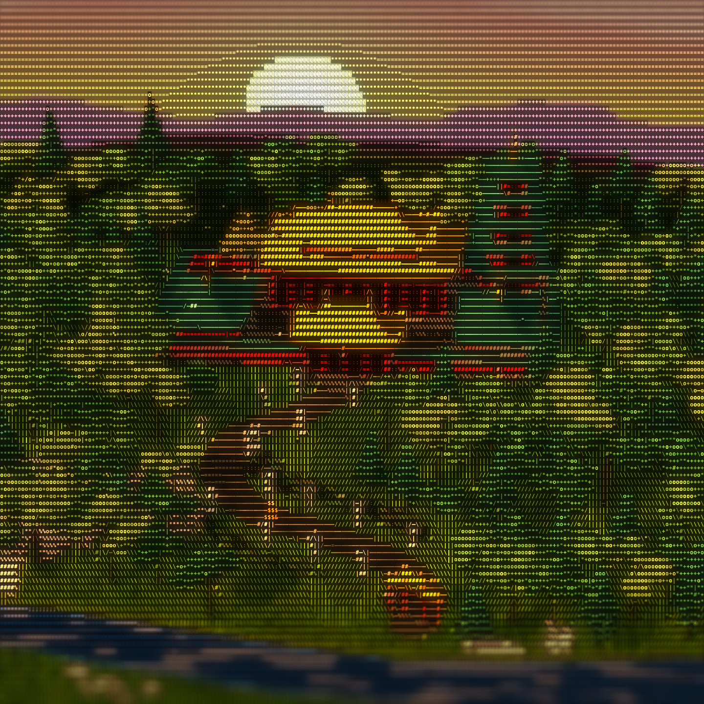

# 山寺夕照 · ASCII 移轴微缩

一座建在山顶的宏伟寺庙，四周是郁郁葱葱的树林，一条石阶小径从山脚的牌坊蜿蜒而上，直到寺庙山门；一轮夕阳正从远山的山脊后落下。
整幅画面由 Three.js 实时渲染，再用着色器转换成彩色等宽字符，上下两端做成移轴摄影般的虚化，像在俯瞰一座精致的模型。



## 场景
- **寺庙**：金色重檐大殿、两侧青绿屋顶的配殿、五层红塔、金顶山门、红墙与香炉，院里一棵银杏、门前两棵红枫
- **山林**：约 250 棵阔叶树与松树，十几万片树叶和草叶随风摇动
- **小径**：缓 S 形石阶从山脚红柱牌坊一路上到山门，两旁交错立着 16 座石灯笼，一个小和尚正拾级而上
- **夕阳**：紫红到金黄的晚霞、飘动的云带，太阳半沉在两层远山之后；山脚有花草地和映着夕光的小溪
- 镜头缓慢左右摆动，无限循环；按空格暂停

## 运行
```bash
npm install
npm run dev      # 打开终端里给出的地址
npm run build    # 静态产物：index.html + build/main.js + assets/，可放到任何静态托管
```
需要独立显卡/集显的浏览器才能流畅运行（场景较重）。URL 参数 `?t=<秒>&freeze` 可定格到某一时刻。

## 素材与许可
- 贴图：Poly Haven（CC0）— leafy_grass、coast_sand_01、aerial_rocks_02、castle_wall_slates、weathered_planks、bark_brown_02
- 渲染管线基于 MIT 许可的 ascii-diorama 模板，许可声明见 `THIRD_PARTY_LICENSE`
